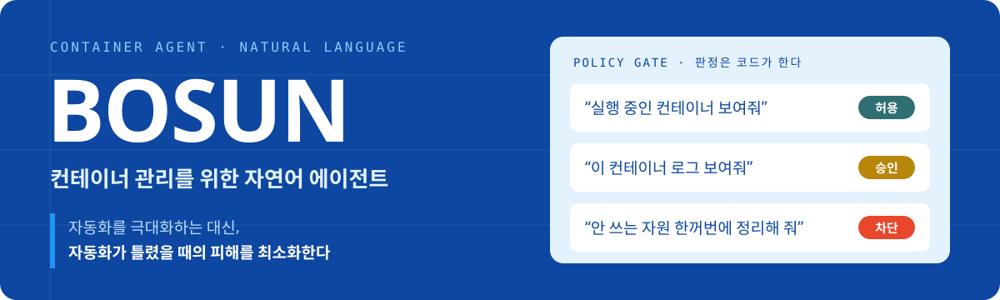

<p align="center">
  
</p>

# BOSUN

**채팅으로 컨테이너(앱)를 만들고 관리하되, 실행해도 되는지는 모델이 아니라 코드가 정한다.**

BOSUN은 컨테이너 관리를 위한 자연어 에이전트다. 사용자는 포트·볼륨·네트워크 같은 용어를 몰라도 "레디스 하나 띄워줘"처럼 말하면 된다.
에이전트는 바로 실행하지 않고 쉬운 말로 계획을 보여 주고, 위험한 작업은 **정책 훅(코드)** 이 먼저 판정하며, 바꾸거나 지우기 전에는 **백업**을 확인한다.
관리 기능은 새로 만들지 않고 검증된 오픈소스 관리 플랫폼 [Portainer](https://www.portainer.io/)를 엔진으로 쓴다.

> 모델이 속거나 틀려도 호스트와 데이터가 한 번에 사라지지 않게 한다.
> 목표는 자동화의 극대화가 아니라 **자동화가 틀렸을 때의 피해 최소화**다.

## 왜 필요한가

| 문제 | BOSUN의 대응 |
|---|---|
| 컨테이너 운영에는 용어와 명령의 벽이 있다 | 자연어로 요청하고, 계획·위험·열리는 포트·데이터 저장 위치를 쉬운 말로 먼저 본다 |
| 자연어는 문턱을 낮추지만 실패의 단위를 키운다("정리해 줘"가 재시작인지 삭제인지 모호) | 판정은 사용자의 문장이 아니라 **최종적으로 호출되는 도구와 인자**를 보고 한다 |
| Portainer API 키는 발급 계정의 권한을 그대로 상속해 인증이 모델의 실수를 막지 못한다 | 모든 호출이 지나는 정책 계층을 앞에 두고, 미분류 도구는 허용하지 않는다 |
| 삭제는 즉시 반영되고 데이터 볼륨까지 지우면 복구 경로가 없다 | 수정·삭제 전 최근 백업을 요구하고, 검증된 백업이 없으면 진행하지 않는다 |

## 아키텍처

<p align="center">
  
</p>

점선 사각형이 `bosun` 컨테이너다. 이 컨테이너에는 **도커 소켓이 없다.** 도커를 조작할 수 있는 컨테이너는 Portainer 하나뿐이고, 호스트 권한은 거기에만 격리된다.
(`mcp-soteria`·백업 컨테이너는 `bosun` 컨테이너 밖에 두는 별도 Portainer 스택이다. 정책 훅이 새 앱 볼륨을 넣고 다시 배포해야 하기 때문이다.)

### 요청 하나가 처리되는 순서

1. 사용자가 채팅창에 요청을 쓴다.
2. **WEB 백엔드**가 대화 상태를 붙여 **docker-agent**에 전달한다.
3. 에이전트가 의도를 해석해 **도구와 인자**를 구성한다(모델은 OpenRouter 경유).
4. **정책 훅**이 호출을 검사해 `허용 / 승인 / 차단`을 판정한다. 훅이 실패하면 호출은 막힌다(fail-closed).
5. 승인 판정이면 화면에 **승인 카드**가 뜬다. 해당 요청 1건에 한해 승인할 수 있고, 시간 안에 응답이 없으면 자동 취소된다.
6. 통과한 호출만 `mcp-portainer → Portainer → Docker`로 실행된다.
7. 응답의 비밀번호·토큰은 모델에 돌려주기 전에 가려진다.
8. 결과가 문장으로 요약되고, 승인·거부·자동 승인 이력이 기록된다.

### 설계 원칙

- **모델은 정책 엔진이 아니다.** 판정은 코드가 한다. 지시문의 "위험한 일을 하지 말라"는 부탁이고, 실행 직전 훅의 인자 검사가 강제다.
- **화면은 에이전트에 직접 닿지 않는다.** 에이전트에는 승인 절차를 끄는 설정이 있어, 웹 백엔드가 중계한다.
- **승인에만 의존하지 않는다.** 승인 피로를 전제로, 위험한 경로는 애초에 닿지 못하게 차단한다.
- **최소 허용.** 검토한 메서드·경로·인자 조합만 허용하고 나머지는 거부한다. 새 API가 생겨도 권한이 자동으로 늘지 않는다.

## 컴포넌트

### WEB — 채팅 화면과 백엔드 (`src/`, `server/`)

React 채팅 화면과 Node(Hono) 백엔드. 에이전트 런타임이 원래 터미널 프로그램이라 기술 용어로 뜨던 승인 질문을 **화면**으로 옮겼다.

- 첫 접속 설정 페이지: OpenRouter 키와 Portainer 키를 받고, 저장 전에 실제로 유효한지 확인한다.
- 승인 카드: 무엇을 하는지, 위험, 열리는 포트, 데이터 저장 위치를 보여 준다. 차단 안내는 승인 카드와 시각적으로 분리하고 이유와 대안만 보여 준다.
- 정책 설정: 작업별 **허용·묻기·막기**를 고른다. 보호 대상과 금지된 실행 경로는 설정 항목이 아니다.
- 백엔드(`server/`)가 docker-agent를 자식 프로세스로 띄우고, 이벤트를 화면 이벤트로 바꾸고, 승인 카드·감사 기록을 SQLite(`web.db`)에 저장한다.
- 로그인이 없으므로 `127.0.0.1`에서만 뜬다. 다른 PC에서는 SSH 터널로 접속한다.

자세한 안내: [`README-web.md`](README-web.md)

### AI Agent — docker-agent와 설정 (`agents/`, `ai-agent-hooks/agent.yaml.example`)

docker-agent **v1.148.0**이 자연어 요청을 도구 호출로 바꾼다. 도구는 MCP로 노출되며, 모델은 OpenRouter의 `deepseek/deepseek-v4.1-flash`다.

| 설정 | 동작 |
|---|---|
| `beginner` (초보자용) | 바꾸기 전에 쉬운 말로 계획을 먼저 보여 주고, 동의하면 실행 |
| `expert` (숙련자용) | 계획 없이 바로 승인 카드로 확인 |

두 모드는 계획 제시 여부만 다르고 **안전 규칙은 같다.**
새 대화를 열어도 `session_start_app_summary` 훅이 현재 앱 목록을 요약해 넣어 이어서 돕는다.

자세한 안내: [`README-agent.md`](README-agent.md)

### 정책 훅 — 실행 직전의 관문 (`ai-agent-hooks/`)

에이전트의 훅 지점(사용자 입력 · 모델 호출 직전 · 도구 실행 직전 · 도구 응답 직후)에 Python 훅을 건다. 도구와 인자를 보고 판정한다.

| 위험도 | 기준 | 대표 작업 |
|---|---|---|
| R0 | 자원을 변경하지 않는 일반 조회 | 컨테이너 목록, 자원 사용량 |
| R1 | 민감정보가 섞일 수 있는 조회 | 로그, 상세 설정, 구성 파일 |
| R2 | 생성·상태 변경 등 운영에 영향 | 시작·정지·재시작, 이미지 다운로드 |
| R3 | 삭제·데이터 손실·임의 명령·권한 상승 | 볼륨 삭제, 구성 변경, 내부 명령 실행 |

판정은 `허용`(승인 없이 실행) · `승인`(요청 1건에 한해 사용자 확인) · `차단`(승인과 무관하게 거부, 사유와 대안 안내) 중 하나다. 판정 순서는 카탈로그 확인 → 위험도 조회 → 인자·구성 검사 → 보호 대상 확인 → 백업 조건 확인 → 판정 반환이다.

| 방어 계층 | 하는 일 | 주요 파일 |
|---|---|---|
| 입력 구분 | 사용자 입력·도구 응답에 섞인 숨은 지시(인젝션) 차단 | `user_prompt_submit_injection_guard.py`, `before_llm_call_injection_sanitizer.py`, `tool_response_transform_injection_guard.py` |
| 위험도 판정 | Docker API 허용 목록(메서드·경로·인자), 직접 생성·`exec`·일괄 정리 거부 | `tool_input_transform_direct_policy_guard.py` |
| 인자 검사 | Compose의 위험 필드, 포트 범위, 공식 이미지만 | `tool_input_transform_stack_guard.py`, `image_source.py` |
| 승인 | 영향도를 쉬운 말로 설명한 승인 카드 | `tool_guard_approval_explainer.py` |
| 백업·감사 | 수정·삭제 전 백업 확인, 비밀값 가리기 | `tool_input_transform_direct_backup_guard.py`, `tool_response_transform_secret_mask.py` |

BOSUN Agent·Portainer·백업 서비스처럼 다른 자원의 관리·복구 기반은 보호 대상이라 변경·삭제할 수 없다.

### Portainer 연동 (`portainer/`)

Portainer CE **2.45.1**을 별도 스택으로 띄우고, 에이전트는 `mcp-portainer` **2.45.1**으로 그 API를 호출한다.
Docker 조작 경로는 두 갈래다: 스택(Compose) 배포 경로와 개별 컨테이너를 다루는 Docker 프록시 경로. 컨테이너는 직접 만들지 않고 **Compose 스택으로만** 만들어, 배포 정의 전체를 확인하고 영향을 설명할 수 있게 했다.
Portainer 대시보드는 관리자 전용이므로 비공개로 둔다.

### 백업 — Soteria와 정시 백업 (`backup/`, `ai-agent-hooks/tools/`)

백업은 에이전트가 다른 관리 도구와 같은 방식으로 호출하는 **MCP 도구**이며, 정책도 같은 기준으로 판정한다(정책이 미치지 않는 경로를 만들지 않기 위해서다).

| | 정시 백업 | 지금 백업 (soteria) |
|---|---|---|
| 언제 | 매일 12시·18시·23시(한국 시간), 7일 보관 | 사용자가 요청할 때, 그리고 데이터가 있는 앱을 수정·삭제하기 전 |
| 무엇으로 | `bosun-backup` 스택 ([offen/docker-volume-backup](https://github.com/offen/docker-volume-backup)) | `bosun-soteria` 스택 + MCP `backup_volume`(승인) · `backup_status`(허용) |

- 실행 중인 앱은 백업이 깨질 수 있어 **정지 → 백업 → 시작** 순서를 훅이 강제한다.
- "백업을 요청했다"는 사실만으로는 보존으로 인정하지 않는다. `succeeded` 상태, 산출물 존재, 0바이트 초과, SHA-256 정보를 모두 요구한다. (이는 복원 성공까지 보장하지는 않는다.)
- 복원은 관리자 작업이다. 에이전트에는 복원 도구를 주지 않고, 관리자용 `ai-agent-hooks/tools/restore_volume.py`가 정지 → 안전 백업 → 볼륨 재생성 → 풀기 → SHA-256 검증 → 재시작을 수행한다.

자세한 안내: [`README-backup.md`](README-backup.md)

## 저장소 구조

| 경로 | 파트 | 무엇 |
|---|---|---|
| `src/`, `index.html`, `vite.config.ts` | WEB | 채팅 화면(React) |
| `server/` | WEB | 백엔드. Agent를 띄우고 대화·승인 카드·정책 차단을 중계 |
| `ai-agent-hooks/` | Agent | 정책 훅·공용 모듈·관리자 도구·테스트, 기준 설정 `agent.yaml.example` |
| `agents/` | Agent | 초보자용·숙련자용 설정 예시 |
| `portainer/`, `backup/` | Agent | Portainer CE 2.45.1, 정시 백업 compose |
| `container/`, `docker-compose.yaml` | 공통 | 컨테이너 설치(웹+Agent 이미지 스택. Portainer는 따로 설치) |
| `docs/` | 공통 | 동작 기준·테스트 목록, 설계·구현 정리, 복원 절차서 |
| `assets/readme/` | 공통 | 이 README의 그림 |

버전 고정: docker-agent **v1.148.0** / mcp-portainer **2.45.1** / Portainer CE **2.45.1** / 모델 `deepseek/deepseek-v4.1-flash`(OpenRouter)

## 문서

| 파일 | 무엇 |
|---|---|
| [`README-web.md`](README-web.md), [`README-agent.md`](README-agent.md) | 파트별 실행·설정·문제 해결 |
| [`README-backup.md`](README-backup.md) | 백업 저장 위치 설정과 soteria 백업 게이트 사용법 |
| [`container/README.md`](container/README.md) | 컨테이너 설치 절차·확인 체크리스트·진단표 |
| [`docs/동작기준_테스트목록.md`](docs/동작기준_테스트목록.md) | 정책표와의 차이·예외, 실제 AI 시나리오 테스트 T01~T42 |
| [`docs/AI_Agent_설계_구현_정리_11-04.md`](docs/AI_Agent_설계_구현_정리_11-04.md) | 설계·구현 정리 |
| [`docs/복원절차서_관리자용_11-07.md`](docs/복원절차서_관리자용_11-07.md) | 볼륨 복원 절차(관리자 작업) |
| [`docs/백업게이트_soteria_검증_결정_11-12.md`](docs/백업게이트_soteria_검증_결정_11-12.md) | 백업 게이트 실측 검증 결과와 팀 결정 |

## 올리면 안 되는 것

`.gitignore`가 막는다. 값이 든 파일은 저장소에 올리지 않는다.

| 파일 | 무엇 |
|---|---|
| `agent.env` | OpenRouter·Portainer 키 (Agent 실행 폴더) |
| `server/real.env` | 웹 ↔ Agent 연동 토큰·경로 |
| `session.db`, `*.sqlite3` | 대화 기록, 백업·주입 기록 |
| `server/data/web.db` | 승인 카드·승인 감사 기록 |
| `agent.yaml`, `agents/*.yaml` | 경로가 PC마다 다른 실제 설정(`.example`만 커밋한다) |

## 한계

- 정책 판정은 고정이지만, 모델이 쓰는 계획 설명의 품질은 균일하지 않다. 카드 문구는 코드가 만들지만 계획 단계 서술까지는 통제하지 못한다.
- 백업은 자동이지만 복원은 관리자 절차에 의존한다.
- 한 사용자가 전체를 관리하는 전제다(다중 사용자 분리 없음). 웹에는 로그인이 없다.
- 기기가 꺼져 있으면 정기 백업을 놓친다.

## 라이선스

MIT ([`LICENSE`](LICENSE))

## 실행

### 1. 키 발급 (직접 발급합니다)

- **OpenRouter API 키**: openrouter.ai → Keys → 키 생성 (`sk-or-…`로 시작)
- **Portainer API 키**: 2단계에서 Portainer를 설치한 뒤에 만듭니다.

### 2. Portainer 설치

```bash
git clone https://github.com/bosun-agent/bosun-agent.git
cd bosun-agent/portainer
docker compose -f portainer-compose.yaml up -d
```

1. 브라우저에서 <https://localhost:9443>을 엽니다. 인증서 경고는 정상이니 계속 진행합니다.
2. 관리자 계정을 만듭니다.
3. **Get Started (local)** 를 눌러 Docker 환경을 등록합니다. 이 단계를 건너뛰면 BOSUN 설정이 저장되지 않습니다.
4. 오른쪽 위 내 계정 → My account → Access tokens에서 API 키를 만듭니다 (`ptr_…`로 시작).

### 3. BOSUN 실행

```bash
cd ..          # bosun-agent 폴더로 돌아옵니다
docker compose up -d --build
```

- 첫 빌드는 몇 분 걸립니다. 그동안 멈춘 것처럼 보여도 기다리면 됩니다.
- 진행 상황은 `docker compose logs -f bosun`으로 봅니다.

### 4. 접속하고 키 넣기

1. 브라우저에서 <http://127.0.0.1:3001>을 엽니다.
2. 첫 화면이 설정 페이지입니다. OpenRouter 키와 Portainer 키를 넣고 저장합니다.
3. 값은 저장 전에 실제로 확인합니다. 틀리면 그 칸 아래에 이유가 나옵니다.

다른 PC에서 접속하려면 SSH 터널을 씁니다. 화면에 로그인이 없어서 이 PC에서만 열립니다.

```bash
ssh -L 3001:127.0.0.1:3001 <사용자>@<서버>
```

터널을 연 뒤 <http://localhost:3001>을 엽니다.

### 5. 백업 켜기 (처음 한 번)

백업 기능을 쓰려면 아래를 한 번만 합니다.

**(1) soteria 이미지 만들기**

```bash
git clone -b fix/gate-request-hardening https://github.com/bosun-agent/soteria.git ~/soteria-src
cd ~/soteria-src && docker build -t soteria:test .
```

**(2) 백업 볼륨 만들기**

```bash
docker volume create bosun_soteria_backups
```

**(3) 창구 스택 만들기 (`bosun-soteria`)**

1. Portainer 화면에서 환경 ID를 확인합니다. 주소의 `#!/1/docker/…`에서 숫자 부분입니다.
2. ID가 3이 아니면 `container/.env`에 `SOTERIA_ENDPOINT_ID=<환경 ID>`를 적고 `docker compose up -d`를 다시 실행합니다.
3. 그다음 [`container/README.md`](container/README.md) 7절 3단계 명령을 실행합니다. 끝에 `창구 응답: 정상`이 나오면 됩니다.

**(4) 정시 백업 스택 만들기 (`bosun-backup`)**

1. Portainer → Stacks → Add stack → 이름 `bosun-backup`
2. 내용은 `backup/bosun-backup-compose.yaml`을 붙여 넣고 Deploy합니다.

### 6. 잘 되는지 확인

BOSUN 화면에서 순서대로 해 봅니다.

1. 아무 말이나 보냅니다. → 모델이 응답하면 정상입니다.
2. "컨테이너 목록 보여줘" → 목록이 나오면 Portainer 연결이 정상입니다.
3. 삭제를 요청합니다. → 승인 카드가 뜨면 정책 훅이 정상입니다.
