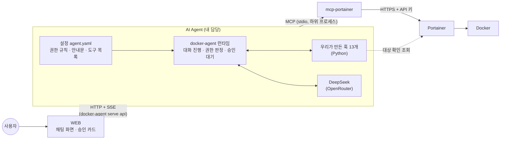
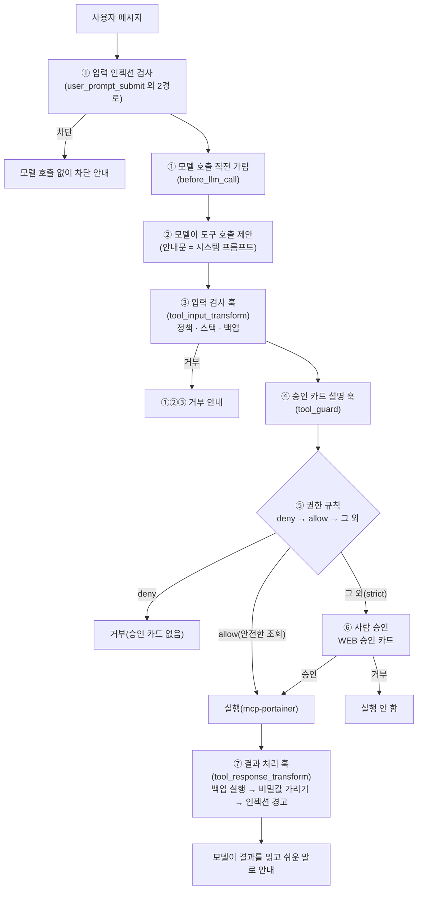

# AI Agent 설계·구현 정리 (11/4)

- 프로젝트: BOSUN 캡스톤. 전문 지식이 없는 초보 사용자가 자연어로 컨테이너를 만들고 관리하게 한다
- 내 역할: AI Agent 담당·결정권자. 맡은 인터페이스는 ① WEB ↔ AI Agent, ② AI Agent → Portainer MCP
- 기준 버전(고정): docker-agent v1.148.0, mcp-portainer 2.45.1, Portainer CE 2.45.1, 모델 deepseek/deepseek-v4.1-flash(OpenRouter, 개발·테스트 단계)
- 함께 보는 문서: `AI_Agent_테스트_문제_수정_종합정리_11-04.md`(테스트·문제·결정), 10/11 `AI-Agent-아키텍처-설계서-직접연결.md`(초기 설계)

---

## 1. 한 줄 요약

**모델(LLM)은 "무엇을 할지" 제안만 하고, 실행 여부는 코드(훅·권한 규칙)와 사람의 승인이 정한다.**
초보자가 실수하거나 모델이 잘못 판단해도 위험한 일이 일어나지 않도록, 막는 장치를 여러 겹으로 두었다.

---

## 2. 전체 구조

| 구간 | 방식 | 비고 |
|---|---|---|
| WEB ↔ Agent | HTTP + SSE(`docker-agent serve api`) | 메시지 보내기, 승인 요청 이벤트 받기, 승인·거부 보내기 |
| Agent ↔ 모델 | HTTPS(OpenRouter) | 키는 env 파일에만 둔다 |
| Agent ↔ mcp-portainer | MCP over stdio | Agent가 mcp-portainer를 직접 실행. 주소가 없어 외부에서 접근 불가 |
| mcp-portainer ↔ Portainer | HTTPS REST + API 키 | 자체 서명 인증서 |
| 훅 ↔ Portainer | HTTPS 조회만 | 실제 대상 확인(ID 고정, Portainer 보호, 이름 표시, 백업 실행) |

---

## 3. 기술 선택과 이유

| 선택 | 이유 | 버린 대안 |
|---|---|---|
| 오케스트레이션: **docker-agent** | YAML 설정 하나로 에이전트 정의, MCP 지원, 훅으로 도구 호출을 실행 전에 가로챌 수 있음, 승인 대기를 런타임이 맡고 SSE로 WEB에 알림, 모델 회사에 묶이지 않음 | Claude Agent SDK(9/20 비교) |
| Portainer 연결: **mcp-portainer 직접 연결(stdio)** | 경로가 짧고 판정·승인을 한 곳(docker-agent)에서 함 | Airlock 경유(10/11 보류. 폐기 아님) |
| 모델: **DeepSeek v4.1 flash(OpenRouter)** | 개발·테스트 단계 비용이 낮음. 모델은 설정 한 줄로 바꿀 수 있음 | — |
| 컨테이너 생성: **스택(Compose)** | Compose 파일 하나를 통째로 검사할 수 있음. 직접 생성(JSON)은 위험 설정을 하나하나 막기 어려움 | `/containers/create`(10/31 금지) |
| 볼륨 백업: **offen/docker-volume-backup v2.50.1** | 오픈소스 조사 결과 가장 적합(볼륨 단위, 예약 백업, 보관 기간, 명령 한 줄로 즉시 백업) | — |

---

## 4. 요청 하나가 처리되는 순서

이 순서는 docker-agent 공식 소스(`pkg/runtime/toolexec/dispatcher.go`, `pkg/hooks/pipeline.go`)로 확인했다.
- 같은 단계의 훅은 앞 훅이 거부해도 모두 실행되고, 결과를 합쳐서 판정한다.
- 결과 처리 훅(tool_response_transform)은 결과를 바꿀 수만 있고 실행을 막지는 못한다.

---

## 5. 방어 층 설계

| 층 | 무엇이 막나 | 성격 | 예 |
|---|---|---|---|
| 1. 안내문(시스템 프롬프트) | 모델이 스스로 위험한 요청을 거절 | 부탁(보장 없음). 말투·행동 원칙만 | "privileged로 만들어줘" → 도구를 부르지 않고 거절 |
| 2. 입력 검사 훅 | 허용 목록 밖 호출, 위험한 Compose 설정, 잘못된 대상 | **강제**. 허용 목록 방식(목록에 없으면 거부) | 80번 포트, restart always, 공식 아닌 이미지 |
| 3. 권한 규칙 deny | 훅에 버그가 있어도 위험한 호출을 막음 | **강제**. 글자 비교(보조 잠금) | exec(백업 예외 제외), 볼륨 삭제, prune, archive |
| 4. 사람 승인(strict) | 규칙에 없는 모든 변경 | 사람이 결정 | 시작·정지·생성·삭제·민감 조회 |
| 5. 결과 처리 훅 | 결과 속 비밀값, 결과에 숨은 인젝션 문구 | 가리기·경고 | `DB_PASSWORD=[REDACTED]` |

**운영 원칙(10/11 결정, 지금도 같음)**
- 강제해야 하는 기준은 훅과 deny에 둔다.
- 안내문에는 모델이 말하고 행동하는 방식만 둔다.
- 테스트가 실패하면 금지 문장을 덧붙이기 전에 "어느 층에서 막아야 하는가"를 먼저 본다.

11/3에는 초보자 기준으로 "까다롭더라도 안전 우선"으로 통제하기로 했다.

---

## 6. Agent가 할 수 있는 일과 없는 일

| 구분 | 작업 | 처리 |
|---|---|---|
| 바로 실행 | 목록 조회(환경·컨테이너·이미지·볼륨·네트워크·스택), 사용량, 네트워크 상세, 이미지 검색 | allow(승인 없음) |
| 승인 후 실행(민감 조회) | 컨테이너 상세(안전 필드만), 로그(최대 200줄), 프로세스 목록, 이미지 상세·이력, 볼륨 상세 | 승인 카드 |
| 승인 후 실행(변경) | 시작·정지·재시작·일시정지·재개, 정지된 컨테이너 삭제(삭제 전 설정 백업), 스택 생성·시작·정지, 공식 이미지 받기, 네트워크 생성(bridge)·연결·해제, 지금 백업 | 승인 카드(한 건씩) |
| 할 수 없음 | 컨테이너 안 명령(백업 명령만 예외), 파일 읽기·내보내기, prune, 강제 종료·강제 삭제, 볼륨 생성·삭제, 이미지·네트워크 삭제, 직접 생성, 스택 수정·삭제, 설정 변경, Portainer 컨테이너 변경 | 훅 + deny |

**스택(Compose) 검사 규칙**

| 규칙 | 내용 |
|---|---|
| 허용 항목 | image, command, entrypoint, environment, ports, expose, 이름 있는 volumes, restart, depends_on, networks(bridge), labels, working_dir, user, hostname, container_name, healthcheck, mem_limit, mem_reservation, cpus, deploy.resources 등 |
| 거부 | privileged, cap_add, devices, 호스트 폴더·docker.sock 마운트, host 네트워크, build, env_file, `${...}` 변수 치환, extends, YAML 태그, container_name portainer 등 |
| restart | no, unless-stopped, on-failure:1~5만 |
| 공개 포트 | 1024~65535(9443·8000 제외) |
| 자원 | 서비스당 메모리 2GB·CPU 2개 상한. 안 적으면 512MB·CPU 1개로 채움 |
| 이미지 | Docker Hub 공식 이미지만(슬래시 없는 이름) |
| 보내는 내용 | 검사한 내용을 다시 YAML로 써서 보냄. 검사한 것과 실행되는 것이 같다 |

---

## 7. 구현: 컴포넌트별

### 7-1. 설정 `agent.yaml`

| 부분 | 내용 |
|---|---|
| `permissions.allow` | 안전한 조회 11개 경로 + EndpointList·StackList + 백업 실행 2단계(`/exec/*/start`, 정책 훅이 확인) |
| `permissions.deny` | 직접 생성, 이미지·네트워크 삭제, exec(bosun-backup 말고 전부: 글자 자리마다 적은 24줄), archive, export, prune, 볼륨 삭제, `%` 인코딩 경로, 이미지 내보내기 |
| `safety: strict` | 규칙에 없는 호출은 모두 승인 |
| `instruction` | [할 수 있는 일] / [도구 사용] / [변경 작업] / [거부·불가 작업 안내]. 결과 단정 금지, ①②③ 전달, 시간 초과 시 재시도 금지 |
| `toolsets` | mcp-portainer 2.45.1을 uvx로 실행. 도구 6개만 노출(docker_proxy, EndpointList, StackList, StackCreateDockerStandaloneString, StackStart, StackStop). 셸 도구 없음 |
| 시간 제한 | PORTAINER_TIMEOUT 120초 < call_timeout 150초 |
| 모델 | max_tokens 4096 |
| 비밀값 | 설정 파일에 적지 않음. env 파일(권한 600) + `--env-from-file`, 설정에는 `${env.…}` 참조만 |

### 7-2. 훅 (모두 Python, `ai-agent-hooks/`)

| 단계 | 훅 | 하는 일 |
|---|---|---|
| 입력 | `user_prompt_submit_injection_guard.py` | 사용자 입력의 확실한 인젝션 문구 차단(일반·steer·followup 세 경로), 차단 기록 |
| 입력 | `before_llm_call_injection_sanitizer.py` | 차단된 입력이 다음 턴 모델 호출에 섞이지 않게 가림 |
| 도구 전 | `tool_input_transform_direct_policy_guard.py` | docker_proxy 허용 목록. 경로 형식 검사, 버전 접두어 제거, 로그 tail 1~200, inspect 안전 필드 강제, 컨테이너를 Portainer에 물어 **전체 ID로 고정**, Portainer 보호, 공식 이미지만 받기, 네트워크 연결 대상 확인, 백업 exec 검사(대상·명령·옵션, 2단계에서 다시 확인) |
| 도구 전 | `tool_input_transform_stack_guard.py` | Compose 검사(6절 규칙), 스택 시작·정지 인자 검사 |
| 도구 전 | `tool_input_transform_direct_backup_guard.py` | 컨테이너 삭제 전 설정(inspect)을 `backups.sqlite3`에 저장. 실패·대상 불명·`v=true`면 삭제 차단 |
| 승인 직전 | `tool_guard_approval_explainer.py` | 실행될 요청을 쉬운 말과 영향(low·medium·high)으로 설명해 승인 카드에 붙임. 컨테이너·스택은 이름으로 표시. 판정은 하지 않음 |
| 결과 | `tool_response_transform_backup_runner.py` | 승인된 백업 준비 뒤에 같은 명령인지 확인하고 바로 실행해 백업 로그를 돌려줌 |
| 결과 | `tool_response_transform_secret_mask.py` | password·token·키 값, Bearer, URL 속 비밀번호, 개인키, 알려진 토큰 모양을 `[REDACTED]`로. Docker 로그 머리 제거. 오류가 나면 결과 전체를 숨김 |
| 결과 | `tool_response_transform_injection_guard.py` | 결과에 인젝션 문구가 있으면 경고를 덧붙임(Docker ID는 오탐에서 제외) |

공용 모듈:
- `portainer_api.py`: Portainer 조회
- `deny_guide.py`: 거부 안내 ①②③
- `image_source.py`: 공식 이미지 규칙
- `injection_patterns.py`: 인젝션 패턴

훅이 고장 나면 안전한 쪽으로 동작한다. 입력 검사 훅이 고장 나면 호출이 막히고(`on_error: block`), 승인 카드 설명 훅이 고장 나면 그 호출이 거부된다.

### 7-3. 볼륨 백업 설계

| 항목 | 내용 |
|---|---|
| 자동 백업 | 중앙 백업 스택 `bosun-backup`이 매일 새벽 3시에 백업하고 7일 보관. 저장 위치는 `bosun_backups` 볼륨. 관리자가 만듦 |
| 지금 백업 | 사용자 요청 → 모델이 `bosun-backup`에 backup 명령 exec를 한 번 보냄 → 정책 훅이 대상·명령 검사 → 사람 승인 1번 → 실행 훅이 바로 실행하고 결과를 돌려줌 |
| 예외의 범위 | exec는 bosun-backup의 `backup` 명령 하나만. 다른 컨테이너나 다른 명령은 훅과 deny 둘 다 막음 |
| 쓰는 중인 DB | 먼저 정지할지 묻고 정지 → 백업 → 시작(각각 승인) |
| 복원 | 관리자 작업 |

### 7-4. 설정 나누기(yq)

팀 공유를 위해 설정을 세 파일(공통·권한·훅)로 나눌 수 있다(`yq-split/`).
- 합칠 때는 `*+`(배열 이어 붙이기)를 쓴다. `*`는 같은 이름의 배열을 통째로 바꿔서 훅과 deny가 조용히 사라진다.
- 합친 결과는 `tools/check_merged_config.py`로 검사한다.

### 7-5. 시험용 WEB `web-test/`

Agent 연동을 확인하려고 만든 최소 화면이다. 본 WEB은 웹 담당 팀원이 만들고, 아래는 본 연동 때 그대로 지켜야 할 것들이다.
- 세션은 고정 제목으로 만든다. 제목 생성 호출로 차단된 입력이 새는 것을 막는다.
- 승인 카드에 훅 설명(`metadata.reason`, 영향 `blast_radius`)을 보여 준다.
- 도구 호출 전의 글은 회색 "진행 중"으로, 최종 답만 말풍선으로 보여 준다.
- 마크다운은 HTML을 먼저 모두 무력화한 뒤 꾸미고, 링크는 만들지 않는다.
- 통계(텔레메트리)는 끈다.

---

## 8. WEB 연동 인터페이스 (① WEB ↔ AI Agent)

| 항목 | 내용 |
|---|---|
| 실행 | `docker-agent serve api agent.yaml --env-from-file <키 파일> --session-db <절대경로> --auth-token <토큰> -l 127.0.0.1:8080`, `TELEMETRY_ENABLED=false` |
| 세션 만들기 | `POST /api/sessions` `{"title": "새 대화"}`(고정 제목 필수) |
| 메시지 | `POST /api/sessions/{id}/agent/agent`(API 이름은 파일 이름 agent) |
| 받는 이벤트(SSE) | `agent_choice`(글), `tool_call`(도구 호출), `tool_call_confirmation`(승인 요청 + `metadata.reason`·`blast_radius`), `hook_blocked`(훅 차단), `tool_call_response`(결과), `stream_stopped`, `error` |
| 승인 응답 | `POST /api/sessions/{id}/resume` `{"confirmation": "approve"}` 또는 `"reject"`만. `approve-tool` 등 자동 승인 API는 쓰지 않음 |
| 시간 제한 권장 | 무소식 60초, 도구 실행 중 360초, 승인 대기 10분, 전체 10분 |
| 오류 표시 | OpenRouter 402(동시 지출 예산)는 일시적이라 "잠시 후 다시 보내 주세요" 안내 |
| 쓰지 않는 것 | 세션 삭제 API, 승인 절차를 끄는 API |

---

## 9. 한계와 남은 설계 과제

| 항목 | 내용 |
|---|---|
| 보안 경계 | 권한 규칙은 Agent 안의 규칙이다. Portainer 키를 가진 다른 경로는 이 규칙을 거치지 않는다. 배포 때 Agent 전용 키, env 파일 권한 600 |
| 모델 말투 | 안내문은 부탁이라 가끔 어긋날 수 있다(11/3 단정 표현). 실행은 훅·규칙이 막으므로 안전에는 영향이 없다 |
| OpenRouter 402 | 짧은 시간에 요청이 몰리면 잔액이 남아 있어도 가끔 거부된다. docker-agent는 4xx를 재시도하지 않는다 |
| 같은 이름 스택 | 거부할지 번호를 붙일지 결정 대기 |
| 스택 수정(StackUpdate) | 아직 지원하지 않음 |
| 두 갈래 제어 | 웹앱은 Docker SDK, Agent는 Portainer 스택으로 만든다. Agent가 만든 스택을 backend "프로젝트"로 등록할지 팀 결정 필요 |
| 확장 | 초보자용·숙련자용 Agent 나누기, MCP 범위 재검토는 나중에 |
